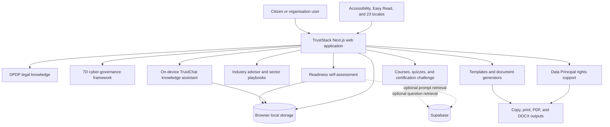
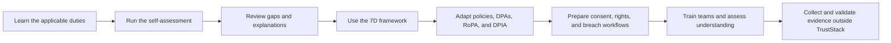
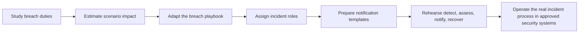
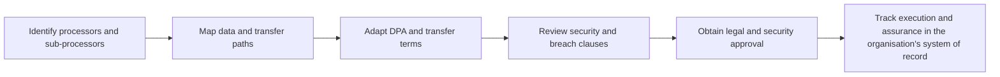

# TrustStack DPDP Cybersecurity Implementation

## 1. Document purpose

This document describes the DPDP-focused cybersecurity, privacy engineering,
cyber-governance, education, and implementation-support capabilities built in
TrustStack.

The solution helps individuals and organisations understand and operationalise
India's Digital Personal Data Protection Act, 2023 (DPDP Act) and the Digital
Personal Data Protection Rules, 2025 through legal guidance, control-oriented
frameworks, self-assessment, document generation, incident-readiness material,
rights workflows, sector playbooks, and practitioner learning.

> **Scope boundary:** Security scanner functionality and every feature that
> depends on a scanner report are intentionally excluded from this document.

## 2. Executive summary

TrustStack is an India-focused DPDP cybersecurity and privacy-readiness web
platform. It translates legal duties into practical cyber-governance activities
that can be understood by citizens, founders, legal teams, privacy teams,
security teams, engineers, HR teams, and senior management.

The implemented platform currently provides:

- a structured knowledge base for all 44 sections and 23 Rules;
- plain-language legal explanations, official-text access, cases, and articles;
- a seven-stage DPDP implementation methodology;
- a user-declared readiness self-assessment with a local score;
- sector-specific cyber-risk playbooks and a deterministic industry advisor;
- privacy notice, consent form, and Data Principal request generators;
- three indicative risk and cost calculators;
- 15 editable governance, processor, rights, and breach-response templates;
- four workplace awareness posters;
- breach-response and third-party risk implementation material;
- role-based courses, interactive learning activities, quizzes, and an exam;
- an on-device DPDP knowledge assistant;
- 23-language localisation, right-to-left support, and site-wide Easy Read;
- accessibility controls for text, contrast, spacing, motion, focus, and speech;
- client-side preference and learning-state persistence; and
- baseline web-response hardening such as anti-framing, MIME-sniffing, referrer,
  and browser-permission headers.

The product is best described as a **DPDP cybersecurity education, readiness,
and implementation-support platform**. It is not a legal determination engine,
an accredited compliance auditor, a SIEM, a SOC platform, or a replacement for
qualified privacy, legal, security, or incident-response professionals.

## 3. Why this is a cybersecurity implementation

The DPDP Act is a personal-data protection law rather than a general-purpose
cybersecurity standard. However, its expected outcomes depend on cybersecurity
and privacy-engineering controls throughout the data lifecycle.

TrustStack connects DPDP duties to the following cyber outcomes:

| DPDP outcome | Cybersecurity purpose |
| --- | --- |
| Know what personal data exists | Data discovery, classification, inventories, data-flow mapping, and shadow-IT awareness |
| Use data only for a stated purpose | Purpose limitation, least-data design, consent controls, and prevention of unauthorised secondary use |
| Protect personal data | Access control, encryption, masking, secure APIs, secrets management, monitoring, and secure deletion guidance |
| Detect and manage a breach | Incident identification, triage, escalation, evidence preservation, notification preparation, and recovery planning |
| Control processors and vendors | Contractual security duties, sub-processor governance, transfer controls, breach clauses, and deletion obligations |
| Honour individual rights | Identity-aware access, correction, erasure, withdrawal, grievance, and nomination workflow design |
| Demonstrate accountability | RoPA, DPIA, policies, processing records, evidence expectations, training, and management reporting guidance |
| Reduce human error | Role-based awareness, scenario exercises, quizzes, and practitioner assessment |

The platform therefore treats privacy compliance as a cyber-governance problem:
organisations must be able to locate personal data, restrict its use, protect
it, detect misuse, respond to incidents, manage third parties, and show evidence
of responsible operation.

## 4. Solution architecture

TrustStack is implemented as a Next.js App Router application with React and
TypeScript. Most interactive tools run in the browser. Optional Supabase access
is used for selected question content when configured, with bundled content as
a fallback.

### 4.1 Main technology choices

| Layer | Implemented technology |
| --- | --- |
| Application framework | Next.js 15 App Router |
| UI runtime | React 19 and TypeScript |
| Styling | Tailwind CSS and project CSS tokens |
| Localisation | next-intl plus generated site translation catalogs |
| Interaction and motion | Framer Motion with reduced-motion support |
| Icons | Lucide React |
| Client PDF output | jsPDF and browser print workflows |
| Document preview | docx-preview with same-origin vendored browser dependencies |
| QR generation | qrcode, loaded client-side for earned certificates |
| Optional content data | Supabase |
| Automated checks | Node/TypeScript tests and content, translation, and Easy Read audits |

## 5. Implemented capability inventory

### 5.1 DPDP Act and Rules knowledge system

TrustStack includes a navigable legal knowledge layer designed to connect cyber
and privacy work to the relevant law.

Implemented capabilities include:

- navigation across 9 chapters and 44 sections of the DPDP Act;
- navigation and filtering across 23 DPDP Rules;
- dedicated section and Rule detail pages;
- official-text presentation alongside explanatory material;
- source and provenance links for official material;
- plain-language summaries and implementation guidance;
- cross-references between duties, sections, and Rules;
- privacy case-law summaries and detailed case pages;
- cybersecurity and DPDP educational articles; and
- official PDF and generated guide download paths where provided by the UI.

Primary routes:

- `/act`
- `/section/[n]`
- `/rules`
- `/rules/[n]`
- `/cases`
- `/cases/[slug]`
- `/blog`
- `/blog/[slug]`

Key implementation files:

- [`src/components/resources/ActBrowser.tsx`](../src/components/resources/ActBrowser.tsx)
- [`src/components/resources/RulesBrowser.tsx`](../src/components/resources/RulesBrowser.tsx)
- [`src/components/resources/OfficialText.tsx`](../src/components/resources/OfficialText.tsx)
- [`src/components/resources/CasesBrowser.tsx`](../src/components/resources/CasesBrowser.tsx)
- [`src/content/act.ts`](../src/content/act.ts)
- [`src/content/rules.ts`](../src/content/rules.ts)
- [`src/content/section-enrichment.ts`](../src/content/section-enrichment.ts)
- [`src/content/blog-articles.ts`](../src/content/blog-articles.ts)
- [`src/content/cases.ts`](../src/content/cases.ts)

**Cybersecurity value:** teams can trace security safeguards, processor duties,
breach responsibilities, children's-data controls, rights handling, and
accountability activities back to a legal reference instead of treating them
as disconnected security tasks.

### 5.2 Seven-stage cyber-governance framework

The `/framework` route presents the Anix 7D DPDP Framework as an interactive,
seven-stage implementation method:

| Stage | Implemented guidance | Cybersecurity relevance |
| --- | --- | --- |
| Discover | Personal-data inventory, vendors, processors, AI touchpoints, cloud stores, and shadow IT | Establishes assets, data locations, ownership, and exposure paths |
| Define | Purpose, legal basis, consent mapping, retention, and RoPA | Establishes authorised use and governance rules |
| Design | Notices, consent withdrawal, rights, grievances, and DPAs | Converts requirements into repeatable workflows |
| Defend | Safeguard gaps, access control, minimisation, encryption, masking, and incident planning | Addresses preventive, detective, and responsive security controls |
| Deploy | SOPs, training, notices, workflows, and vendor terms | Moves policy into operational teams |
| Demonstrate | Evidence expectations, maturity reporting, risk views, and documentation | Supports accountability and management oversight |
| Drive | Ongoing reviews, DPO support, vendor review, AI review, and annual audit guidance | Promotes continuous governance rather than one-time compliance |

Implementation references:

- [`src/components/sections/FrameworkSection.tsx`](../src/components/sections/FrameworkSection.tsx)
- [`src/content/dpdp.ts`](../src/content/dpdp.ts)
- [`src/app/framework/page.tsx`](../src/app/framework/page.tsx)

The current implementation is an interactive methodology and guidance surface.
It does not itself discover systems, execute encryption, collect evidence, or
operate a production compliance workflow.

### 5.3 DPDP readiness self-assessment

The homepage includes a user-driven DPDP readiness check. It is a questionnaire,
not a technical inspection.

The implemented flow:

1. Presents a set of DPDP control and governance questions.
2. Lets the user mark each item as `Covered`, `In progress`, or `Gap`.
3. Calculates a transparent weighted readiness value:

   $$
   \text{Readiness} =
   \frac{\text{Covered} + 0.5 \times \text{In progress}}
   {\text{Total questions}} \times 100
   $$

4. Displays counts for covered items, work in progress, gaps, and unanswered
   questions.
5. Provides plain-language explanations for individual assessment questions.
6. Stores answers in browser storage so a visitor can continue later on the
   same device.
7. Can retrieve assessment prompts from Supabase when configured and falls
   back to bundled translated prompts otherwise.

Implementation references:

- [`src/components/home/RiskCheck.tsx`](../src/components/home/RiskCheck.tsx)
- [`src/components/home/RiskGuide.tsx`](../src/components/home/RiskGuide.tsx)
- [`src/content/risk-explainers.ts`](../src/content/risk-explainers.ts)

The score reflects only the visitor's answers. It is not independent evidence,
an audit result, or a legal conclusion.

### 5.4 Sector cyber-risk playbooks and industry advisor

TrustStack includes DPDP playbooks for six operating environments:

- BFSI;
- healthcare;
- education;
- SaaS and IT;
- e-commerce; and
- government.

Each playbook connects sector data types to likely cyber and privacy risks,
including KYC records, financial transactions, patient data, children's data,
employee information, behavioural data, cross-border processing, cloud and AI
use, delivery partners, and public-sector datasets.

The DPDP Industry Advisor implements a deterministic four-step conversation:

1. Select a sector.
2. Select the primary personal-data category handled.
3. Select the most relevant risk or concern.
4. Select the organisation's current readiness stage.

It then returns authored sector guidance covering why DPDP matters, relevant
obligations, a plausible incident scenario, risk context, and three suggested
first actions.

Implementation references:

- [`src/app/industries/page.tsx`](../src/app/industries/page.tsx)
- [`src/components/sections/IndustriesSection.tsx`](../src/components/sections/IndustriesSection.tsx)
- [`src/components/sections/IndustryAdvisor.tsx`](../src/components/sections/IndustryAdvisor.tsx)
- [`src/content/industry-advisor.ts`](../src/content/industry-advisor.ts)

The advisor uses authored branch logic. It does not use a live AI model, inspect
an organisation, validate controls, or calculate an evidence-based risk rating.

### 5.5 Cyber-risk and cost calculators

The `/tools` route contains three browser-based estimators:

| Calculator | Inputs | Output |
| --- | --- | --- |
| Penalty exposure | Failure type, affected scale, duration, repetition, gain, and mitigation | Indicative exposure, range, statutory cap, and section reference |
| Compliance ROI | Record count, industry profile, present maturity, and planned investment | Modelled annual exposure, residual exposure, ROI, and payback period |
| Breach cost | Exposed records, data sensitivity, and detection time | Modelled total cost, per-record cost, detection/response cost, and notification/legal cost |

All formulas are deterministic and execute on the client in
[`src/components/sections/Calculators.tsx`](../src/components/sections/Calculators.tsx).

These tools are scenario-planning aids. Their outputs are not legal advice,
actuarial forecasts, guaranteed penalties, or guaranteed financial returns.

### 5.6 Privacy notice and consent document studio

The browser-based document studio builds two live drafts:

- a Section 5-oriented privacy notice; and
- a Section 6-oriented consent form.

Users can enter organisation details, data categories, processing purposes,
retention language, contact details, and withdrawal instructions. The tool then
assembles the selected document and supports copy, print, and browser PDF output.

The generator also switches its generated body when Easy Read mode is active.
Input is held in React state and the component does not submit it to a server.

Implementation reference:

- [`src/components/sections/Generators.tsx`](../src/components/sections/Generators.tsx)

Generated text is a starting draft and requires organisation-specific review,
control validation, and qualified legal approval before production use.

### 5.7 Data Principal rights support

The `/rights` route gives individuals a plain-language view of six rights:

- access personal data;
- correct or complete data;
- erase data;
- withdraw consent;
- raise a grievance; and
- nominate another person.

The route also covers:

- the grievance escalation path;
- children's and guardian protections;
- Data Principal duties; and
- frequently asked questions.

The Rights Request Generator creates formal letters for all six request types.
Users provide their own details, organisation, reference, and request context,
then copy, print, or download the result as a PDF. Generation is client-side.

Implementation references:

- [`src/app/rights/page.tsx`](../src/app/rights/page.tsx)
- [`src/components/sections/RightsRequestGenerator.tsx`](../src/components/sections/RightsRequestGenerator.tsx)
- [`src/content/rights.ts`](../src/content/rights.ts)
- [`src/lib/pdf.ts`](../src/lib/pdf.ts)

The platform generates a request. It does not verify identity, deliver the
request, open a case, enforce a response deadline, or retain a case record.

### 5.8 DPDP implementation template library

TrustStack includes 15 substantial implementation templates, organised into
forms, policies, agreements, and breach materials.

#### Forms and notices

| No. | Template |
| ---: | --- |
| 1 | Consent form for data processing |
| 2 | Data Principal rights request form |
| 3 | Consent withdrawal request |

#### Policies and governance records

| No. | Template |
| ---: | --- |
| 4 | Privacy policy |
| 5 | Data retention policy |
| 6 | Data protection policy |
| 7 | Cookie policy |
| 8 | Employee data protection policy |
| 9 | Data Protection Impact Assessment (DPIA) |
| 10 | Record of Processing Activities (RoPA) |

#### Processor and transfer agreements

| No. | Template |
| ---: | --- |
| 11 | Data Processing Agreement (DPA) |
| 12 | Cross-border transfer agreement |
| 13 | Vendor and sub-processor DPA |

#### Breach response

| No. | Template |
| ---: | --- |
| 14 | Personal-data breach notice pack |
| 15 | Breach response playbook |

The library supports filtering, readable in-browser documents, DOCX preview,
and downloadable DOCX and PDF assets. Document detail pages describe intended
use and identify example organisation content that must be replaced.

Four printable awareness posters are also included:

- Know your rights
- Consent done right
- Spot a data breach
- Protect children's data

Implementation references:

- [`src/app/templates/page.tsx`](../src/app/templates/page.tsx)
- [`src/app/templates/[slug]/page.tsx`](../src/app/templates/[slug]/page.tsx)
- [`src/components/resources/TemplatesBrowser.tsx`](../src/components/resources/TemplatesBrowser.tsx)
- [`src/components/resources/TemplateFormatViewer.tsx`](../src/components/resources/TemplateFormatViewer.tsx)
- [`src/components/resources/TemplateDownloads.tsx`](../src/components/resources/TemplateDownloads.tsx)
- [`src/content/templates.ts`](../src/content/templates.ts)
- [`src/content/template-documents.ts`](../src/content/template-documents.ts)

### 5.9 Breach-response readiness

The non-scanner platform supports incident preparedness through:

- a breach-cost scenario calculator;
- a four-phase `detect, assess, notify, recover` response playbook;
- Board and affected-person notification templates;
- incident roles and escalation guidance;
- post-incident review material;
- sector-specific breach scenarios;
- legal and operational learning content; and
- awareness material for identifying and reporting a breach.

This is preparatory content and document support. The current application does
not provide incident intake, a live notification clock, regulator submission,
message delivery, forensic evidence capture, chain of custody, or incident case
management.

### 5.10 Processor, vendor, and cross-border governance

Third-party cyber risk is addressed through:

- processor and sub-processor explanations;
- DPA and vendor-DPA templates;
- security, audit, breach, deletion, and sub-processor contract clauses;
- a cross-border transfer agreement and transfer-register material;
- sector-specific vendor risk narratives;
- guidance to inventory processors and data flows; and
- course and knowledge-base content on fiduciary accountability.

These assets help an organisation design a third-party governance programme.
The current application does not operate a vendor inventory, due-diligence
questionnaire, contract approval workflow, assurance review, or continuous
third-party monitoring service.

### 5.11 Consent and cookie preference experience

The site includes a consent-preference interface for:

- essential cookies;
- functional cookies;
- analytics cookies; and
- marketing cookies.

The user can accept all, reject non-essential categories, customise choices,
and reopen preferences later. A version and timestamp are stored locally, and
the active categories are reflected on the document root.

Implementation reference:

- [`src/components/site/CookieConsent.tsx`](../src/components/site/CookieConsent.tsx)

This is a front-end preference and demonstration layer. No enterprise consent
ledger, authenticated identity binding, proof export, registered Consent Manager
integration, or independent verification of downstream tag enforcement is
implemented in this component.

### 5.12 TrustChat DPDP knowledge assistant

TrustChat is an on-device, deterministic knowledge assistant. It matches a user
question against an authored DPDP knowledge base and returns the strongest
keyword match.

Covered topics include:

- Data Principals, Fiduciaries, Processors, and Significant Data Fiduciaries;
- notice and valid consent;
- consent withdrawal;
- security safeguards and breaches;
- children's data;
- Data Principal rights and grievances;
- cross-border transfers;
- retention and deletion;
- penalties and the Data Protection Board; and
- sector-specific DPDP questions.

Up to 40 recent messages are kept in browser storage and can be cleared by the
user.

Implementation references:

- [`src/components/site/LexBot.tsx`](../src/components/site/LexBot.tsx)
- [`src/content/lexbot-kb.ts`](../src/content/lexbot-kb.ts)

TrustChat is not a generative AI system, live legal-research service, or legal
advisor. It does not retrieve changes in law at query time.

### 5.13 Role-based learning and cyber-awareness

TrustStack includes role-oriented DPDP courses for different audiences rather
than presenting one generic legal course to everyone.

The learning implementation contains:

- course routes with authored modules and lessons;
- learning outcomes and section-mapped material;
- flashcards and module quizzes;
- scenario sorting exercises;
- decision-path exercises;
- term-matching activities;
- practical consent, rights, processor, safeguards, breach, and governance
  content;
- a general knowledge quiz; and
- locally persisted learning progress and achievements.

Implementation references:

- [`src/app/courses/page.tsx`](../src/app/courses/page.tsx)
- [`src/app/courses/[slug]/page.tsx`](../src/app/courses/[slug]/page.tsx)
- [`src/components/courses/CourseInteractive.tsx`](../src/components/courses/CourseInteractive.tsx)
- [`src/content/courses.ts`](../src/content/courses.ts)
- [`src/content/course-lessons.ts`](../src/content/course-lessons.ts)
- [`src/content/course-activities.ts`](../src/content/course-activities.ts)
- [`src/content/curriculum.ts`](../src/content/curriculum.ts)

### 5.14 Practitioner assessment and certificate experience

The certification area implements:

- an eight-module programme overview;
- a timed, five-question exam experience;
- random question ordering;
- question navigation and answered/unanswered tracking;
- automatic submission when time expires;
- answer review and explanations;
- a perfect-score requirement in the current exam runtime;
- optional Supabase retrieval of a capped question subset;
- fallback to bundled questions when Supabase is unavailable;
- a browser-generated certificate ID;
- holder-entered name, role, and organisation;
- an on-screen certificate with issue and validity dates; and
- a QR link to the certificate verification route.

Implementation references:

- [`src/app/certification/page.tsx`](../src/app/certification/page.tsx)
- [`src/app/certification/exam/page.tsx`](../src/app/certification/exam/page.tsx)
- [`src/components/sections/DpdpExam.tsx`](../src/components/sections/DpdpExam.tsx)
- [`src/components/sections/CertificateStudio.tsx`](../src/components/sections/CertificateStudio.tsx)
- [`src/app/certification/verify/page.tsx`](../src/app/certification/verify/page.tsx)
- [`supabase/secure_questions.sql`](../supabase/secure_questions.sql)

The current verification page validates the syntax of a certificate ID. It does
not query a trusted issuance registry, bind the ID to the holder, validate the
exam event, or check revocation. The certificate should therefore be positioned
as an educational/demo credential, not an accredited professional licence or
proof that an organisation complies with the DPDP Act.

### 5.15 Accessibility and inclusive security communication

Cybersecurity and privacy controls fail when users cannot understand notices,
warnings, rights, or required actions. TrustStack includes accessibility as a
core implementation feature.

The accessibility toolbar provides:

- three text-size levels;
- three line-spacing levels;
- high-contrast mode;
- readable-font mode;
- reduced-motion mode;
- underlined links;
- reading-focus mode;
- site-wide Easy Read;
- browser speech-synthesis read-aloud; and
- reset to defaults.

Preferences are stored locally and applied through document-level classes and
CSS variables.

Implementation references:

- [`src/components/site/A11yToolbar.tsx`](../src/components/site/A11yToolbar.tsx)
- [`src/components/site/ReadingMode.tsx`](../src/components/site/ReadingMode.tsx)
- [`src/components/site/EasyTextRuntime.tsx`](../src/components/site/EasyTextRuntime.tsx)
- [`src/components/site/EasyContent.tsx`](../src/components/site/EasyContent.tsx)

### 5.16 India-first localisation

The application supports 23 locales: English plus 22 Indian languages. Language
names are displayed in native scripts, and Urdu, Sindhi, and Kashmiri use
right-to-left presentation.

The localisation system covers:

- navigation and shared interface messages;
- hard-coded page and component content through generated runtime catalogs;
- dynamic interface labels and accessibility attributes;
- locale persistence through a cookie;
- right-to-left document direction; and
- translation audits and route checks.

Implementation references:

- [`src/i18n/locales.ts`](../src/i18n/locales.ts)
- [`src/components/LanguageSwitcher.tsx`](../src/components/LanguageSwitcher.tsx)
- [`src/components/site/LocaleTextRuntime.tsx`](../src/components/site/LocaleTextRuntime.tsx)
- [`messages`](../messages)
- [`public/i18n/site`](../public/i18n/site)
- [`scripts/audit-translations.mjs`](../scripts/audit-translations.mjs)
- [`scripts/audit-i18n-routes.mjs`](../scripts/audit-i18n-routes.mjs)

Translated and Easy Read explanations improve access but do not replace the
official legislative text or qualified interpretation.

## 6. Data handling and privacy design

### 6.1 Browser-local processing

The following interactions are designed to execute in the browser:

- readiness answers and score calculation;
- calculator inputs and outputs;
- privacy notice generation;
- consent form generation;
- Data Principal request-letter generation;
- TrustChat question matching;
- accessibility preferences;
- cookie preferences;
- theme and reading preferences;
- selected learning progress; and
- certificate artwork and QR generation.

Browser storage is used for convenience and continuity. It is not a durable,
tamper-resistant, multi-user audit store.

### 6.2 Optional Supabase use

When environment configuration is present, Supabase may provide:

- readiness-assessment prompts; and
- a limited random/capped set of exam questions.

The application retains bundled fallback content so these learning experiences
remain available when Supabase is not configured or is unavailable.

### 6.3 Output generation

Depending on the feature, users can:

- copy generated content to the clipboard;
- open a print view;
- use the browser's PDF print capability;
- generate a client-side PDF;
- preview a DOCX document; or
- download prepared DOCX and PDF assets.

No approval, e-signature, records-management, or document-lifecycle workflow is
implemented by these output controls.

## 7. Application-level safeguards

The public web application includes baseline response and browser protections:

- `frame-ancestors 'self'` and `X-Frame-Options: SAMEORIGIN` against external
  framing and common clickjacking scenarios;
- `X-Content-Type-Options: nosniff`;
- `Referrer-Policy: strict-origin-when-cross-origin`;
- browser geolocation, microphone, and camera disabled through
  `Permissions-Policy`;
- production browser source maps disabled;
- static-asset and HTML cache rules; and
- guarded browser-storage helpers that tolerate unavailable storage and quota
  failures.

Implementation references:

- [`next.config.ts`](../next.config.ts)
- [`src/lib/safe-storage.ts`](../src/lib/safe-storage.ts)

The project also contains user-interface deterrents for casual copying and
inspection. These are not security boundaries and must not be treated as access
control or data-loss prevention.

## 8. Capability status matrix

| Capability | Status in this codebase | Important boundary |
| --- | --- | --- |
| DPDP Act and Rules knowledge | Implemented | Educational and explanatory, not legal advice |
| Official-text and provenance access | Implemented | Official source remains authoritative |
| Seven-stage implementation framework | Implemented as interactive guidance | Does not execute or validate controls |
| Readiness questionnaire | Implemented | User-declared score, not an independent assessment |
| Sector playbooks | Implemented | Authored guidance, not environment discovery |
| Industry advisor | Implemented as deterministic branches | No live AI or organisational inspection |
| Penalty, ROI, and breach-cost calculators | Implemented | Heuristic and indicative only |
| Privacy and consent generators | Implemented client-side | Drafts require tailoring and review |
| Rights-request generator | Implemented client-side | Does not send or manage requests |
| Template and poster library | Implemented | Example content must be adapted |
| Breach-response material | Implemented as templates and guidance | No incident case management or notification delivery |
| Processor and transfer material | Implemented as templates and guidance | No vendor inventory or continuous monitoring |
| Cookie preference UI | Implemented | Not an enterprise consent ledger or proven tag-control system |
| TrustChat | Implemented as local keyword matching | Not generative AI or live legal research |
| Role-based courses and activities | Implemented | Educational content, not workplace control evidence |
| Timed exam and certificate UI | Implemented | Verification currently checks ID format only |
| Easy Read and accessibility controls | Implemented | Browser capability affects speech support |
| 23-locale system | Implemented | Automated translations are not authoritative legal translations |
| Readiness dashboard shown on `/framework` | Illustrative UI mockup | Not a connected production dashboard |
| Evidence vault, consent register, rights tracker, breach tracker, and real-time scorecard described in service copy | Product/service concepts only | No operational back-office implementation verified here |

## 9. Cybersecurity workflows supported

### 9.1 Organisation readiness workflow

### 9.2 Breach-readiness workflow

### 9.3 Third-party governance workflow

## 10. Primary route map

| Route | Purpose |
| --- | --- |
| `/` | Platform overview and user-declared readiness self-assessment |
| `/act` | DPDP Act chapter and section browser |
| `/section/[n]` | Detailed section explanation and official text |
| `/rules` | DPDP Rules browser and filters |
| `/rules/[n]` | Detailed Rule content |
| `/framework` | Seven-stage implementation framework and illustrative platform view |
| `/industries` | Six sector playbooks and deterministic industry advisor |
| `/tools` | Calculators and privacy/consent document studio |
| `/rights` | Data Principal rights guidance and request-letter generator |
| `/templates` | Governance, agreement, form, and breach template library |
| `/templates/[slug]` | Template preview and downloads |
| `/learn` | Learning hub, quiz, and role pathways |
| `/courses` | Course catalog |
| `/courses/[slug]` | Course lessons and interactive activities |
| `/certification` | Practitioner programme and exam entry |
| `/certification/exam` | Timed assessment and certificate experience |
| `/certification/verify` | Certificate ID format-check route |
| `/cases` | Privacy case-law library |
| `/blog` | DPDP and cybersecurity articles |
| `/privacy` | Site privacy notice |
| `/cookies` | Cookie information and preference guidance |
| `/terms` | Site terms |

## 11. Claims that should not be made

To keep the product technically and legally accurate, do not describe the
current non-scanner implementation as providing any of the following:

- a legal declaration that an organisation is compliant or non-compliant;
- accredited certification or a professional licence;
- independent verification of organisational controls;
- vulnerability assessment, penetration testing, or source-code analysis;
- live security monitoring, SIEM, SOC, DLP, or anomaly detection;
- automated data discovery or data classification;
- a durable or tamper-evident audit trail;
- a production evidence vault;
- a consent ledger tied to authenticated Data Principals;
- a rights-request case-management system;
- an operational 72-hour breach countdown;
- regulator filing or affected-person notification delivery;
- continuous vendor or processor monitoring;
- guaranteed penalty, breach-cost, ROI, or remediation outcomes;
- authoritative legal translation;
- a live generative-AI legal advisor; or
- production readiness without legal, privacy, and security review.

## 12. Recommended product description

The following description accurately represents what has been built:

> **TrustStack is a DPDP cybersecurity education, readiness, and
> implementation-support platform for India. It converts the DPDP Act and
> Rules into practical cyber-governance guidance, sector playbooks,
> self-assessment, privacy and rights tools, processor and breach templates,
> and role-based learning. Its browser-first tools help teams prepare policies,
> workflows, and awareness material while keeping human legal, privacy, and
> security review in control.**

## 13. Quality and maintainability controls

The repository includes automated support for:

- TypeScript type checking;
- security-manager-independent content tests;
- Easy Read source and route audits;
- translation catalog audits;
- multilingual route audits;
- template generation;
- Act and Rules content generation; and
- production builds through Next.js.

Relevant files include:

- [`tests/easy-read.test.ts`](../tests/easy-read.test.ts)
- [`tests/certification.test.ts`](../tests/certification.test.ts)
- [`scripts/audit-easy-read.mjs`](../scripts/audit-easy-read.mjs)
- [`scripts/audit-easy-routes.mjs`](../scripts/audit-easy-routes.mjs)
- [`scripts/audit-translations.mjs`](../scripts/audit-translations.mjs)
- [`scripts/audit-i18n-routes.mjs`](../scripts/audit-i18n-routes.mjs)
- [`scripts/generate-templates.mjs`](../scripts/generate-templates.mjs)
- [`scripts/build-act-content.mjs`](../scripts/build-act-content.mjs)
- [`scripts/build-rules-content.mjs`](../scripts/build-rules-content.mjs)

## 14. Conclusion

TrustStack currently delivers a substantial DPDP cyber-governance experience,
not merely a collection of legal pages. It combines legal traceability,
readiness reflection, sector-specific risk communication, implementation
documents, incident-preparation assets, individual-rights support, third-party
governance material, training, accessibility, and India-first localisation.

Its strongest cybersecurity contribution is converting abstract privacy duties
into actions that security and governance teams can understand and prepare for:
inventory personal data, restrict its purpose, protect access, manage vendors,
plan for incidents, support individual rights, train people, and maintain
evidence in the organisation's approved systems.

The platform should continue to be presented as decision support and
implementation enablement. Final legal interpretation, control operation,
evidence validation, incident handling, and compliance accountability remain
with the organisation and its authorised professionals.
