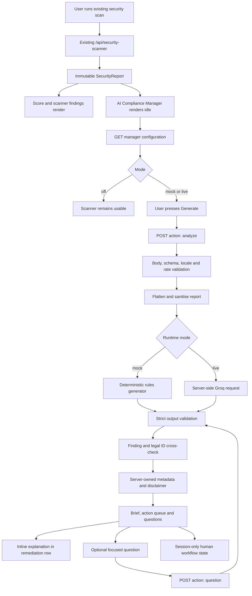

# Automated AI Compliance Manager

Implementation map, operating guide, and verification record for the explainable
AI-assisted compliance workbench added to TrustStack's `/security` scan result.

## 1. What was added

The existing DPDP public-site security scanner still owns every score, status,
finding, evidence string, remediation item, and deeper-assessment limitation.

The new manager adds an optional layer that can:

- organise current scanner findings into an executive brief;
- create a prioritised human review queue under `Do now`, `Plan next`, and `Monitor`;
- explain a finding beside its existing remediation row;
- connect recommendations only to a fixed, code-owned DPDP reference allowlist;
- ask for internal evidence that a public scan cannot observe;
- answer one focused question about the current report;
- track local demo workflow states: `Open`, `In progress`, and `Human verified`;
- run in deterministic mock, live Groq, or off mode; and
- generate live prose in the selected locale and reading mode.

It does **not**:

- change scanner scoring or finding statuses;
- declare an organisation legally compliant or non-compliant;
- create a second compliance percentage;
- inspect internal systems;
- execute a remediation;
- mark an action complete without a person;
- create a durable audit trail; or
- replace legal, privacy, DPO, security, or management review.

The visible product qualifier is:

> Demo - AI-assisted, human-approved

## 2. Where the feature appears

Open:

```text
http://localhost:3000/security
```

After the existing scanner returns a report, the page renders in this order:

1. Existing deterministic score and scan summary.
2. Automated AI Compliance Manager workbench.
3. Existing capability cards.
4. Existing prioritised remediation rows.
5. Existing deeper-assessment limitations.
6. Existing service CTA.

When analysis exists, a matching `AI explanation` disclosure is also rendered inside
each relevant remediation row. The first matching explanation opens by default.

The integration point is
[`src/components/tools/DpdpSecurityScanner.tsx`](../src/components/tools/DpdpSecurityScanner.tsx).

## 3. End-to-end architecture



Important boundary: receiving a scanner report does not call Groq. A provider request
can occur only after the user presses `Generate explainable plan` or submits a focused
question.

## 4. Complete file map

### 4.1 New core files

| File | Purpose |
| --- | --- |
| [`src/components/tools/AiComplianceManager.tsx`](../src/components/tools/AiComplianceManager.tsx) | Main client workbench: configuration check, explicit opt-in, context form, state machine, cancel support, tabs, provenance, local workflow state, locale drift handling, and focused Q&A. |
| [`src/components/tools/ComplianceExplanation.tsx`](../src/components/tools/ComplianceExplanation.tsx) | Accessible inline explanation rendered inside remediation rows in the required order: observed fact, AI interpretation, DPDP connection, uncertainty, and human check. |
| [`src/lib/security-compliance-contract.ts`](../src/lib/security-compliance-contract.ts) | Shared strict Zod schemas and inferred TypeScript types for scanner input, manager requests, model output, final responses, focused questions, configuration, and safe errors. |
| [`src/lib/server/security-compliance-manager.ts`](../src/lib/server/security-compliance-manager.ts) | Server-only manager engine: flattening, sanitisation, deterministic mock generation, prompts, Groq fetch, timeout, parsing, validation, ID cross-checking, safety filters, and server-owned metadata. |
| [`src/app/api/security-compliance-manager/route.ts`](../src/app/api/security-compliance-manager/route.ts) | Same-origin Node API route for safe configuration, analysis, and focused questions. Owns request size checks, locale fallback, demo rate limiting, no-store responses, and safe error mapping. |
| [`src/content/security-compliance-legal.ts`](../src/content/security-compliance-legal.ts) | Fixed legal-reference IDs, labels, summaries, and local links. The model never supplies a URL. |
| [`src/content/easy/security.ts`](../src/content/easy/security.ts) | Normal/Easy Read pairs for all substantive static manager copy. |
| [`tests/security-compliance-manager.test.ts`](../tests/security-compliance-manager.test.ts) | Direct server tests for mock/off/live behavior and hostile or malformed provider output. |
| [`scripts/verify-security-compliance-manager.mjs`](../scripts/verify-security-compliance-manager.mjs) | Secret-free HTTP verification harness for deterministic mock mode. |
| [`scripts/verify-live-security-compliance-manager.mjs`](../scripts/verify-live-security-compliance-manager.mjs) | Secret-free real-provider verifier. Makes one live analysis and one live focused-question request, then prints only structural results. |
| [`docs/security-compliance-manager.md`](security-compliance-manager.md) | This implementation and operating guide. |

### 4.2 Existing files updated

| File | Change |
| --- | --- |
| [`src/components/tools/DpdpSecurityScanner.tsx`](../src/components/tools/DpdpSecurityScanner.tsx) | Keeps manager analysis in report scope, mounts the workbench after the score, resolves explanations by existing finding ID, renders inline disclosures, and resets everything through a URL-plus-scan-time report key. |
| [`src/content/easy/index.ts`](../src/content/easy/index.ts) | Registers the new security Easy Read dictionary. |
| [`next.config.ts`](../next.config.ts) | Adds a narrow final `Cache-Control: no-store` rule for `/api/security-compliance-manager`. |
| [`package.json`](../package.json) | Adds manager test/verification commands and the required dependencies. |
| [`package-lock.json`](../package-lock.json) | Locks the new dependency versions. |
| [`scripts/translate-site-content.mjs`](../scripts/translate-site-content.mjs) | Excludes server-only/API/contract strings and identifier-only templates from browser translation catalogs. |
| [`scripts/audit-translations.mjs`](../scripts/audit-translations.mjs) | Recognises the current prop-based, conditional `LocaleTextRuntime` mount. |

### 4.3 Generated translation files

The normal site translation workflow regenerated:

- [`public/i18n/site/source.json`](../public/i18n/site/source.json)
- all 22 non-English catalogs in [`public/i18n/site/`](../public/i18n/site/)

Do not edit generated catalog entries manually. Change source copy, then run:

```powershell
npm run translate:site
npm run audit:i18n
```

### 4.4 Local-only configuration

`.env.local` contains the local runtime mode and provider secret. It is intentionally
ignored by the repository's `.env*` rule and must not be committed, copied into docs,
or exposed through a `NEXT_PUBLIC_*` variable.

The actual key is deliberately not reproduced in this document.

## 5. Client workbench

The main client state is an explicit discriminated union:

```ts
type ManagerState =
  | { phase: "idle" }
  | { phase: "checking" }
  | { phase: "ready"; mode: "live" | "mock" | "off" }
  | { phase: "analyzing"; mode: "live" | "mock" }
  | { phase: "done"; analysis: ManagerAnalysis }
  | { phase: "error"; code: ManagerErrorCode; detail: string; runId?: string };
```

### Before analysis

The workbench shows:

- what data is sent;
- what the public scanner cannot determine;
- how Groq is used in live mode;
- sector;
- user perspective;
- children, health, or financial high-impact context;
- active-breach state; and
- an explicit warning not to enter personal, confidential, credential, or account data.

If `activeBreach` is `yes`, a deterministic alert immediately tells the user to
escalate to incident, legal, privacy, and security leads and review Section 8(6) and
Rule 7. This alert does not depend on model availability.

### During analysis

- The existing scanner report remains visible.
- An `AbortController` backs the cancel button.
- Unmounting the report also aborts an in-flight request.
- No fake percentage or hidden chain-of-thought is shown.
- Progress labels describe only product-owned validation stages.

### Completed analysis

The workbench has three keyboard-operable tabs:

1. **Brief** - attention level, headline, summary, supported and unsupported
   conclusions, engine/model provenance, language, schema version, time, run ID, and
   permanent disclaimer.
2. **Action queue** - actions grouped into `Do now`, `Plan next`, and `Monitor`, with
   related findings, owner role, verification steps, legal anchors, assumptions,
   confidence, and local workflow state.
3. **Questions to verify** - at most six evidence questions for controls the public
   scan cannot observe.

Tabs implement Left/Right arrow, Home, and End keyboard behavior with roving
`tabIndex`.

### Inline explanation

`ComplianceExplanation` always renders in this semantic order:

1. `Observed fact`
2. `AI interpretation`
3. `DPDP connection`
4. `Uncertainty`
5. `Human check`

Scanner/model values are marked with `data-easy-ignore`, `data-i18n-ignore`, and
`translate="no"` so static DOM translation cannot alter evidence, confidence enums,
or already-localised live model prose. Surrounding labels and controls still use the
site translation and Easy Read systems.

### Focused question

The completed workbench includes `Ask about this report` rather than a floating chat.

- Maximum question length: 500 characters.
- No file or policy upload.
- Only the current question and answer stay in React state.
- The answer must reference current finding IDs, unless it explicitly says the report
  cannot support the question.
- An unsupported answer must be low-confidence and must not assert a legal anchor.

## 6. Local human workflow

Each action can be marked:

- `Open`
- `In progress`
- `Human verified`

Selecting `Human verified` requires a non-empty evidence note of at most 240
characters. Focus moves into the evidence field and returns to the status control on
save or cancel.

Only status and the note are stored in `sessionStorage`. The key is an FNV-1a hash of:

```text
normalised host + scanned_at + action ID
```

The note is never included in analysis or focused-question request payloads. This is
demo workflow state, not certification and not a compliance system of record.

## 7. Shared contracts

[`src/lib/security-compliance-contract.ts`](../src/lib/security-compliance-contract.ts)
contains strict schemas for:

- scanner report input;
- categorical manager context;
- analysis request;
- focused-question request;
- safe configuration response;
- evidence links;
- finding explanations;
- manager actions;
- verification questions;
- raw model analysis;
- final server-owned analysis;
- focused-question response; and
- safe error responses.

Important enforced limits include:

| Field | Limit |
| --- | ---: |
| Request body | 256 KB |
| Flattened findings | 60 |
| Sanitised finding strings | 1,000 characters |
| Headline | 140 characters |
| Executive summary | 1,200 characters |
| Explanations | 12 |
| Actions | 10 |
| Verification questions | 6 |
| Focused question | 500 characters |
| Verification steps or assumptions per item | 5 |

Objects use strict Zod schemas, so unknown output keys, arbitrary URL fields, HTML
fields, and malformed nested structures are rejected rather than partially rendered.

## 8. Report flattening and sanitisation

`flattenSecurityReport()` creates stable `ManagerFinding` records from capability
checks and remediation items.

It:

- preserves scanner IDs and statuses;
- includes each capability check once;
- de-duplicates remediation by ID;
- trims and caps strings;
- sorts `fail`, then `partial`, then `unknown`, then `pass`;
- limits the provider context to 60 findings; and
- normalises the scanned target to hostname only.

The provider does not receive:

- URL credentials;
- URL path, query, or fragment;
- raw HTML;
- full response bodies;
- browser workflow notes;
- source code;
- internal evidence; or
- provider credentials.

Prompt-safe evidence replaces raw `<`/`>` delimiters and neutralises URL schemes before
being sent. After validation, the final displayed `observedFact` is replaced with the
exact scanner-owned evidence from the current report.

## 9. Legal-reference allowlist

The model can return only these IDs:

| ID | Display label | UI route |
| --- | --- | --- |
| `DPDP_ACT_S8` | DPDP Act, Section 8 | `/section/8` |
| `DPDP_ACT_S8_1` | DPDP Act, Section 8(1) | `/section/8` |
| `DPDP_ACT_S8_5` | DPDP Act, Section 8(5) | `/section/8` |
| `DPDP_ACT_S8_6` | DPDP Act, Section 8(6) | `/section/8` |
| `DPDP_RULE_6` | DPDP Rules, Rule 6 | `/rules/6` |
| `DPDP_RULE_7` | DPDP Rules, Rule 7 | `/rules/7` |

The model receives IDs, labels, and short summaries, but no authority to create a
link. React resolves every link from
[`src/content/security-compliance-legal.ts`](../src/content/security-compliance-legal.ts).
An unknown legal ID rejects the complete model response.

## 10. Server manager

[`src/lib/server/security-compliance-manager.ts`](../src/lib/server/security-compliance-manager.ts)
begins with `import "server-only"` and owns:

- mode resolution;
- deterministic mock analysis and Q&A;
- both server-side system prompts;
- Groq request construction;
- provider timeout handling;
- JSON parsing;
- schema validation;
- finding and legal ID validation;
- duplicate ID validation;
- observed-fact consistency checks;
- generated-text safety checks; and
- final server metadata.

### Provider request

Live requests use native server-side `fetch` against the OpenAI-compatible Groq
endpoint with:

- configured model;
- temperature `0` for deterministic compliance JSON;
- configurable token cap, default `5000` and clamped to `1000-8000`;
- `response_format: { type: "json_object" }`;
- one batched analysis call; and
- a 30-second abort timeout.

The provider key is used only in the server-side `Authorization` header.

### Output safety

The complete response is rejected if it contains or references:

- an unknown finding ID;
- an unknown legal-reference ID;
- changed observed evidence;
- duplicate action or explanation IDs;
- HTML or script markup;
- arbitrary URLs;
- legal verdict language;
- certification or approval verdicts;
- an invented compliance percentage; or
- a shape outside the strict schema.

The analysis prompt explicitly forbids chain-of-thought and asks only for concise
user-facing rationale. It also forbids the words `compliant`, `non-compliant`,
`certified`, and `approved` in generated fields, directing the model to use neutral
human-review language instead. The validator remains the final authority.

Server-owned fields are added only after validation:

- `schemaVersion`;
- `runId`;
- `generatedAt`;
- engine/provider/model provenance;
- output language; and
- the permanent disclaimer.

## 11. API route

Endpoint:

```text
/api/security-compliance-manager
```

Runtime:

```ts
export const runtime = "nodejs";
export const dynamic = "force-dynamic";
```

### `GET`

Returns only:

```ts
{
  mode: "live" | "mock" | "off";
  model: string | null;
  provider: "groq" | "deterministic-mock" | null;
  configured: boolean;
}
```

It never returns key existence details, key length, account data, or provider tokens.

### `POST`

Supports two discriminated actions:

```text
action: analyze
action: question
```

The route:

1. requires `application/json`;
2. checks declared and measured body size;
3. validates the request with Zod;
4. validates/falls back locale through the central site registry;
5. applies a process-local demo rate limit;
6. dispatches to mock/live/off behavior;
7. returns only validated data or a safe error; and
8. adds a run ID and `Cache-Control: no-store`.

Demo rate limits per client address and 10-minute window:

| Action | Limit |
| --- | ---: |
| Analysis | 5 |
| Focused question | 10 |

Production must replace the process-local map with a shared store or API gateway
policy.

Stable error codes:

- `invalid_request` - 400
- `request_too_large` - 413
- `rate_limited` - 429
- `ai_not_configured` - 503
- `provider_unavailable` - 502
- `provider_timeout` - 504
- `invalid_model_output` - 502

Safe errors can include a run ID. They never include the provider response body,
prompt, report evidence, user question, stack trace, or secret.

## 12. Runtime modes and local configuration

Configure `.env.local` or the deployment secret store:

```dotenv
AI_COMPLIANCE_MODE=mock
GROQ_API_KEY=
GROQ_MODEL=llama-3.3-70b-versatile
GROQ_API_BASE=https://api.groq.com/openai/v1
GROQ_MAX_TOKENS=5000
```

Never place a real key in documentation, source control, client code, or a
`NEXT_PUBLIC_*` variable.

| Mode | Behavior |
| --- | --- |
| `mock` | No network call. Generates deterministic report-based English output with permanent mock labelling. |
| `live` | Calls the explicitly configured Groq model only after a user action. Missing key/model is a configuration error; no silent model switch occurs. |
| `off` | Scanner stays fully usable. Manager explains that AI analysis is disabled. |

Defaults when `AI_COMPLIANCE_MODE` is absent:

- development: `mock`
- production: `off`

Restart Next.js after changing environment values.

The local workspace is currently configured for live Groq mode. The credential was
shared during development and should be rotated. Replace the value in `.env.local`,
then restart the server.

## 13. Easy Read and multilingual behavior

Static workbench copy is covered by:

- [`src/content/easy/security.ts`](../src/content/easy/security.ts)
- [`src/content/easy/index.ts`](../src/content/easy/index.ts)
- the generated catalogs under [`public/i18n/site/`](../public/i18n/site/)

All 22 non-English site catalogs pass the translation audit with:

- zero missing exact strings;
- zero missing patterns;
- zero placeholder errors; and
- current source fingerprints.

At request time, the client reads:

```text
document.documentElement.lang
document.documentElement.dataset.reading
```

Live model prose uses the requested locale. Easy Read asks the model for shorter,
everyday language. JSON keys and identifiers remain English.

If language or reading mode changes after analysis:

- the existing result stays visible;
- it is labelled as generated in its original mode;
- a regenerate control appears; and
- no automatic provider request occurs.

Mock prose is currently English and is explicitly labelled as such.

## 14. Dependencies and scripts

Added runtime dependencies:

| Package | Reason |
| --- | --- |
| `zod` | Runtime validation for browser requests, scanner reports, model JSON, final responses, and safe errors. |
| `server-only` | Explicit server module boundary for provider logic and credentials. |

Added development dependency:

| Package | Reason |
| --- | --- |
| `tsx` | Runs the TypeScript server tests directly under Node's test runner. |

Added npm commands:

```text
npm run test:compliance-manager
npm run verify:compliance-manager
npm run verify:compliance-manager:live
```

## 15. Verification coverage

### Server test suite

Run:

```powershell
npm run test:compliance-manager
```

Current suite: 16 passing tests covering:

- off mode with no provider call;
- live mode without a key;
- provider timeout;
- provider authentication failure;
- unavailable configured model;
- malformed provider JSON;
- unknown finding ID;
- unknown legal-reference ID;
- HTML/script output;
- arbitrary URL output;
- verdict language;
- valid live finalisation;
- server-owned metadata and disclaimer;
- deterministic provider temperature;
- grounded focused questions; and
- explicit unsupported-question behavior.

### Mock HTTP and adversarial harness

`npm run verify:compliance-manager` requires the running server to be in `mock` mode.
It performs 11 checks:

- safe no-store configuration metadata;
- non-JSON rejection;
- 256 KB request limit;
- strict request schema;
- grounded deterministic analysis;
- active-breach priority;
- prompt-injection containment;
- URL credential/path/query stripping;
- evidence length cap;
- deterministic repeated output;
- all-unknown/no-remediation behavior;
- grounded focused questions; and
- the five-analysis rate limit.

Switch `.env.local` to mock and restart the server before running this harness.

### Real Groq verifier

With live mode configured, run:

```powershell
npm run verify:compliance-manager:live
```

This makes one real analysis request and one real focused-question request. It prints
only validated provenance, counts, grounding booleans, and confidence. It never prints
model prose or credentials.

The verified live path returned:

- Groq engine/provider provenance;
- model `llama-3.3-70b-versatile`;
- schema version `1.0`;
- known finding IDs only;
- allowlisted legal IDs only;
- unchanged scanner evidence;
- server-owned disclaimer and run ID;
- HTTP 200 for analysis and focused question; and
- `Cache-Control: no-store`.

### Static and localization gates

```powershell
npm run typecheck
npx eslint src/app/api/security-compliance-manager/route.ts src/lib/server/security-compliance-manager.ts src/lib/security-compliance-contract.ts src/content/security-compliance-legal.ts src/components/tools/AiComplianceManager.tsx src/components/tools/ComplianceExplanation.tsx src/components/tools/DpdpSecurityScanner.tsx tests/security-compliance-manager.test.ts scripts/verify-security-compliance-manager.mjs scripts/verify-live-security-compliance-manager.mjs
npm run audit:i18n
```

Do not run `next build` while `next dev` is using the same `.next` directory.

### Browser verification completed

The implemented workbench was verified for:

- zero provider calls before Generate;
- scanner score appearing before the manager;
- deterministic breach escalation before analysis;
- correct outgoing locale, reading mode, and categorical context;
- no key or local evidence note in requests;
- keyboard tab navigation;
- all three action horizons;
- Human verified evidence-note requirement and focus behavior;
- zero network calls during local status changes;
- all five inline explanation labels;
- legal links limited to local allowlisted routes;
- malicious evidence rendered as inert text;
- Easy Read static swaps without altering generated evidence/confidence;
- locale changes causing no automatic request;
- no horizontal overflow or clipped controls at 390, 768, and 1440 CSS pixels;
- light and dark themes; and
- live analysis and focused Q&A.

## 16. Security controls

| Threat | Control |
| --- | --- |
| API-key exposure | `.env.local`, `server-only`, native server fetch, no key field, no `NEXT_PUBLIC_*` variable, no raw provider errors. |
| Prompt injection in scanner evidence | Typed projection, structured JSON payload, explicit untrusted-data prompt, string caps, URL neutralisation, output ID validation. |
| Fabricated citations | Fixed legal ID registry; unknown IDs reject the whole response; React owns links. |
| XSS | Plain React text only; no model Markdown parser and no `dangerouslySetInnerHTML` in manager components. |
| Confidential-data leakage | Categorical context only; no file/evidence upload; normalized hostname; no report/question logging. |
| Cost abuse | Explicit CTA, one batched call, question-per-submit, request cap, rate limit, timeout, token cap, disabled in-flight controls. |
| Fake autonomy | No action tools; no external mutations; model cannot set Human verified; permanent demo/disclaimer copy. |
| Unsafe output | Strict Zod schemas, finding/legal cross-checks, exact fact restoration, markup/URL/verdict/percentage filters. |
| Stale analysis | Manager remount key uses report URL and scan timestamp; new scans clear prior analysis. |
| Cached sensitive response | Route and `next.config.ts` both enforce `Cache-Control: no-store`. |

Live verification also confirmed that provider keys, bearer headers, scanner evidence,
and focused-question text do not appear in server logs, rendered configuration
metadata, HTML, or client bundles.

## 17. Running the feature

### Start the app

```powershell
npm run dev
```

Then open:

```text
http://localhost:3000/security
```

The existing public-site scan still requires the existing standalone scanner service,
configured through `SCANNER_SERVICE_URL` when it is not running at the default local
address.

### Use the workbench

1. Enter a public website address.
2. Run the existing security scan.
3. Review the deterministic score and summary.
4. Review the manager's data disclosure.
5. Optionally select categorical context.
6. Press `Generate explainable plan`.
7. Review Brief, Action queue, and Questions to verify.
8. Open the inline explanation beside a remediation finding.
9. Optionally ask one focused question.
10. Use local workflow states only as demo markers.

## 18. Maintenance guide

### Add a legal reference

1. Add the ID and metadata to
   [`src/content/security-compliance-legal.ts`](../src/content/security-compliance-legal.ts).
2. Verify the label, summary, and route against reviewed repository legal content.
3. Add/update tests for accepted and rejected IDs.
4. Run typecheck, server tests, mock verification, and the translation audit.

Never accept a model-supplied URL.

### Change the output contract

Update together:

1. Zod schemas in `security-compliance-contract.ts`.
2. Prompt output description in `security-compliance-manager.ts`.
3. Mock generator.
4. Cross-validation/finalisation logic.
5. React rendering.
6. Unit and HTTP verification fixtures.

Do not render partially valid model output.

### Add or change static UI text

1. Edit the component.
2. Add the normal/Easy pair to `src/content/easy/security.ts` where needed.
3. Run `npm run translate:site`.
4. Run `npm run audit:i18n`.

### Change the model

Set `GROQ_MODEL` explicitly and restart the server. Do not silently switch models in
code. Run `npm run verify:compliance-manager:live` before using the new model in a
demo.

## 19. Known demo limitations

- Workflow state is browser-session only.
- Rate limiting is process-local.
- Mock dynamic prose is English.
- Live output quality depends on the explicitly configured provider model, but every
  response must still pass the server contract.
- A public website scan cannot establish internal access control, encryption at rest,
  backup recovery, log retention, processor contracts, incident readiness, or actual
  breach response.
- The manager is decision support, not a legal determination, certificate, regulator
  submission, or system of record.

## 20. Current status

- Existing scanner facts and scoring: unchanged.
- Mock mode: implemented and adversarially verified.
- Live Groq mode: configured and verified with real analysis and focused Q&A.
- Off mode: implemented and tested.
- Inline explanations: implemented.
- Local human workflow: implemented.
- Focused Q&A: implemented.
- Easy Read: implemented.
- All 22 non-English site catalogs: complete and audit-clean.
- TypeScript, focused lint, 16 server tests, HTTP checks, responsive browser checks,
  and live secret-boundary checks: passing.

The final experience is designed to show the evidence first, label interpretation as
AI-generated, connect only to reviewed legal anchors, state uncertainty, and leave the
decision with a human.
